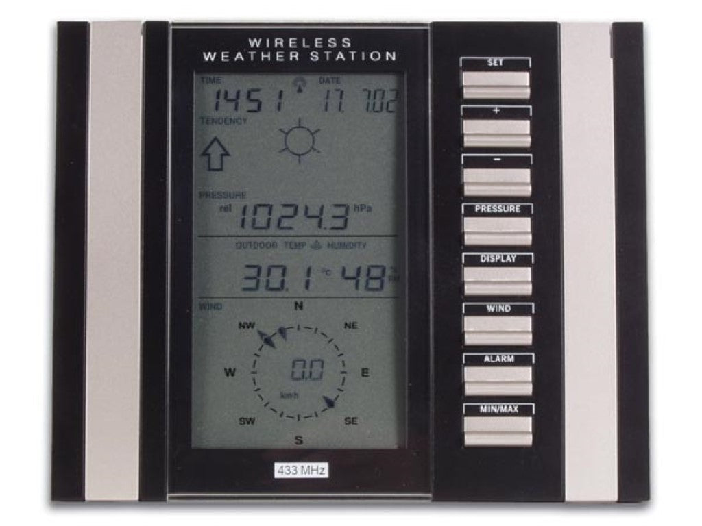
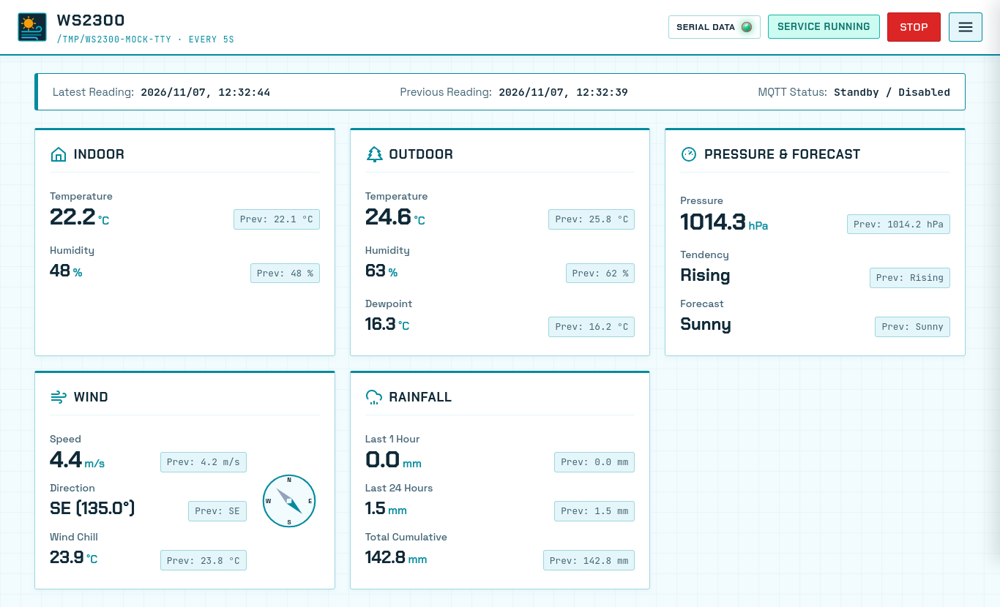

# WS2300 Weather Station Telemetry & Web UI

<p align="center">
  
</p>

A 100% pure Rust telemetry daemon, Web UI, and MQTT publisher for the **La Crosse Technology WS2300** weather station (originally inspired by [Open2300](http://www.lavrsen.dk/foswiki/bin/view/Open2300/WebHome) and part of the [Uncontrolled Mechanical Ventilation](https://hackaday.io/project/12708-uncontrolled-mechanical-ventilation) project).

<p align="center">
  
</p>

*WS2300 Web UI dashboard displaying real-time sensor metrics, previous comparisons, hardware serial link status, and wind compass.*

---

## Hardware Protocol & Memory Architecture

Detailed documentation of the WS2300 physical serial protocol and device memory layout is maintained under the [`doc/`](doc/) directory:
- [**WS2300 Serial Protocol & API (`doc/ws2300_api.md`)**](doc/ws2300_api.md): Explains the 2400-baud nibble communication format, addressing commands (`0x82 + nibble*4`), read acknowledgments, checksum validation, and reset sequences.
- [**WS2300 Memory Map (`doc/memory_map_2300.txt`)**](doc/memory_map_2300.txt): Full hardware memory address table covering indoor/outdoor temperature nibbles, dewpoint, humidity, wind direction/speed, rain gauges, and station alarm registers.

---

## Key Features

- **Light Tropical-Blue Web UI**:
  - **Dashboard Default Page**: Displays real-time **Latest** and **Previous** sensor readings side-by-side along with exact reading timestamps, barometric tendency, station forecast, and a dynamic SVG wind compass.
  - **Anonymous / Public Telemetry Viewing**: Live weather telemetry is viewable without logging in. Settings and service start/stop controls are protected behind authentication.
  - **Distinctive Typography & Sharp Geometry**: Styled with `Chakra Petch`, `Space Grotesk`, and `JetBrains Mono` (`tabular-nums`) using crisp `3px` architectural corners and badges.
  - **Hamburger Navigation Drawer with Contextual Auth**: Slide-out navigation menu providing quick jumps to the Dashboard and Settings. Shows **"Log In →"** when unauthenticated and switches to **"Log Out ⎋"** when authenticated.
  - **Custom Weather Logo & Icons**: Embedded vector weather iconography and favicon/manifest.
- **Service Control & Serial Port Management**:
  - **Start / Stop Service** directly from the top header bar (requires login when OIDC is enabled).
  - **Serial Port Discovery**: Scan and select available serial ports (`/dev/ttyUSB0`, `/dev/ttyS0`, etc.) and configure polling intervals.
- **Include / Exclude `WIND` and `RAIN` Metrics**:
  - Independently toggle `include_wind` and `include_rain` in Settings (`config.yaml`).
  - When disabled, the respective metrics are skipped during 2400-baud serial polling (speeding up station reads), hidden from the Web UI Dashboard, and omitted from MQTT JSON payloads.
- **Out-of-Bounds Value Clamping**:
  - Configure valid `[min, max]` bounds for every sensor metric.
  - Automatically replaces out-of-bounds sensor spikes/error sentinels with the **previous valid value** during processing and flags clamped metrics on the Dashboard.
- **MQTT Telemetry Publisher**:
  - Publishes sanitized readings to an MQTT broker with configurable host, port, username/password authentication, topic, client ID, and retain flag.
- **Stale Data Watchdog & Multi-Channel Alerts**:
  - Triggers an alert when no valid values are received for `N` minutes (`stale_timeout_minutes`).
  - Supports **Email (SMTP)**, **Telegram Bot API**, and **Generic Webhook URLs** (compatible with Ntfy, Gotify, Slack, Discord, and Apprise).
- **Optional OIDC Authentication & Role Gating**:
  - Toggleable OpenID Connect (OIDC) login flow (`oidc.enabled`) supporting standard discovery, authorization code flow with **RFC 7636 PKCE (S256)**, and authenticated user indicator in the header.
  - When unauthenticated, visitors have read-only access to weather telemetry while Settings and service controls remain secured.
- **Atomic YAML Configuration**:
  - All settings are stored in `config.yaml` (see [`config.example.yaml`](config.example.yaml)).

---

## OpenID Connect (OIDC) & Single Sign-On

WS2300 includes built-in OIDC identity authentication to protect configuration and service management while keeping dashboard metrics public.

### Anonymous Viewing & Auth-Gating
- **Unauthenticated / Guest Visitors**: Can view live weather readings, trends, and SSE telemetry events. The top header Start/Stop button and Settings drawer navigation item are hidden, and the hamburger drawer presents a **"Log In →"** link.
- **Authenticated Users**: The top header displays a human torso outline with the logged-in username, reveals the **Start/Stop** service controls, unlocks the **Settings** view, and provides **"Log Out ⎋"**.
- **OIDC Disabled (`oidc.enabled = false`)**: If authentication is disabled, Settings and service controls are open to everyone, and no username badge or login links are displayed.

### Security & PKCE Support
- **Proof Key for Code Exchange (RFC 7636 PKCE)**: WS2300 implements the `S256` code challenge and verifier flow during the authorization code exchange, protecting against code interception attacks.
- **Header Profile Pill**: Once logged in, the active username or email is displayed in the top header beside a user icon, along with a quick-logout shortcut.

### System CA Trust & Private PKI (Cargo.toml Configuration)
WS2300 uses `reqwest` compiled with `rustls-tls-native-roots`:
```toml
reqwest = { version = "0.12", default-features = false, features = ["json", "rustls-tls-native-roots"] }
```
Unlike standard Rust TLS configurations that only bundle public Mozilla root certificates, this allows WS2300 to **inherit the host operating system's trust store** (such as `/etc/ssl/certs/ca-certificates.crt`).

To trust an internal or private Certificate Authority (such as for internal Authelia or Keycloak instances):
```bash
# Debian / Ubuntu host or Docker container:
sudo cp my-private-ca.crt /usr/local/share/ca-certificates/
sudo update-ca-certificates
```

> [!NOTE]
> Ensure internal CA and server certificates comply with RFC 5280 by including `X509v3 Authority Key Identifier` (AKID) and `X509v3 Subject Key Identifier` extensions for strict TLS handshake validation.

### Sample Authelia Client Configuration

Below is an anonymized sample client definition to add to Authelia's `configuration.yml` under `identity_providers.oidc.clients`:

```yaml
identity_providers:
  oidc:
    clients:
      - client_id: 'ws2300-web'
        client_name: 'WS2300 Weather Station'
        consent_mode: 'implicit'
        # Generate with: authelia crypto hash generate pbkdf2 --variant sha512
        client_secret: '$pbkdf2-sha512$310000$exampleSalt$exampleHash...'
        public: false
        authorization_policy: 'one_factor' # Or 'two_factor' depending on your security policy
        scopes:
          - 'openid'
          - 'profile'
          - 'email'
          - 'groups'
        redirect_uris:
          - 'https://ws2300.example.com/auth/callback'
        grant_types:
          - 'authorization_code'
        response_types:
          - 'code'
        access_token_signed_response_alg: 'none'
        userinfo_signed_response_alg: 'none'
        token_endpoint_auth_method: 'client_secret_post'
        require_pkce: true
        pkce_challenge_method: 'S256'
```

### Corresponding WS2300 `config.yaml` Settings

```yaml
oidc:
  enabled: true
  issuer_url: "https://authelia.example.com"
  client_id: "ws2300-web"
  client_secret: "yourPlainTextClientSecret"
  redirect_url: "https://ws2300.example.com/auth/callback"
  session_secret: "generate-a-secure-random-32-byte-hex-string"
```

---

## Building & Deploying the Latest Binary to `./bin` with Docker

All Rust source files are located in [`src/`](src/), while [`bin/`](bin/) is dedicated exclusively to compiled executables.

To compile the release binary inside Docker and export it directly to `./bin/ws2300` on your host:

```bash
./scripts/build-to-bin.sh
```

Or run the `docker build` export command directly:

```bash
docker build -f docker/Dockerfile --target export-bin --output type=local,dest=./bin .
```

---

## Starting & Viewing the UI Against a Mock WS2300 (Virtual PTY Serial)

Use the included [`scripts/run-mock-ui.sh`](scripts/run-mock-ui.sh) script to build `./bin/ws2300` (if not yet built), create a virtual serial port PTY (`/tmp/ws2300-mock-tty`) speaking the exact byte-for-byte WS2300 2400-baud nibble protocol, start the Web UI server, and open `http://localhost:8080` in your browser:

```bash
./scripts/run-mock-ui.sh
```

*(Pass `./scripts/run-mock-ui.sh --build` to force a fresh Docker rebuild of `./bin/ws2300` first.)*

---

## Deploying with Docker Compose

A ready-to-use Docker setup with inline build is located in the [`docker/`](docker/) directory:

```bash
cd docker
docker compose up -d --build
```

The Web UI will be available at `http://localhost:8080`, and configuration changes made in the UI will persist in `docker/config/config.yaml`.

To pass through a physical USB/RS232 serial adapter, uncomment the `devices` mapping in [`docker/docker-compose.yml`](docker/docker-compose.yml):

```yaml
    devices:
      - /dev/ttyUSB0:/dev/ttyUSB0
```

---

## Running Locally

### Web UI & Telemetry Service
```bash
./bin/ws2300 --config config.yaml
```

### Serial Port Troubleshooting (`Device or resource busy`)
If you encounter `Serial Status Warning: Device or resource busy (os error 16)`, a background system daemon on Linux (typically `ModemManager` or `brltty`) is locking the USB-to-serial adapter:
```bash
# Check if ModemManager is running
systemctl status ModemManager

# Stop and disable ModemManager from locking serial devices
sudo systemctl stop ModemManager.service
sudo systemctl disable ModemManager.service
```

### One-Shot CLI JSON Output
For backwards-compatible single-read JSON output to stdout:
```bash
./bin/ws2300 --once /dev/ttyUSB0
```

---

## Development & Quality Checks

Run the full test suite, formatting verification, and strict Clippy lints:

```bash
cargo fmt -- --check
cargo clippy --all-targets --all-features -- --deny warnings
cargo test --all-targets --all-features
```
